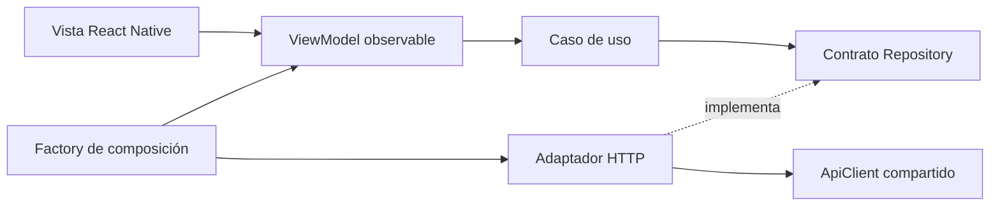

# Arquitectura y contratos comprobados

Expo SDK 57, React Native 0.86 y Expo Router. `src/app` contiene rutas; `src/features` agrupa funcionalidades; `src/core` separa transporte/configuración/validación; `src/ui` comparte componentes. Se reutiliza el backend NestJS existente. La versión 1.1 añade módulos de sesión y privacidad, con dos tablas nuevas creadas de forma idempotente; no crea otro backend ni activa sincronización destructiva de esquemas.

El cliente envía JSON y Bearer, usa timeout, cancela solicitudes y valida respuestas. La URL base es `EXPO_PUBLIC_API_URL` con el prefijo `/api` que ya usa `backend/src/main.ts`. Nunca contiene secretos. Datos públicos del cliente y credenciales del servidor son conceptos distintos.

Contratos leídos del backend local:

| Método y ruta relativa | Entrada / respuesta |
|---|---|
| POST /auth/login | `{email,password,mobile:true}` → JWT corto, usuario y refresh opaco; sin `mobile:true` conserva el contrato web |
| POST /auth/refresh | `{refreshToken}` → sesión rotada; reutilizar uno consumido revoca su familia |
| POST /auth/mobile/logout | `{refreshToken}` → revoca la sesión aun con access JWT vencido |
| POST /auth/logout | Bearer → `{message}`; revoca sesión por jti |
| GET /studies | search, type, status, page, limit → `{data,meta:{page,limit,total}}` |
| GET /studies/:id | Estudio directo |
| GET /studies/:id/details | Arreglo de parámetros/categorías |
| PATCH /users/update-password | `{current_password,password}` → `{message}` |
| GET /users/me | Bearer → `{id,nombre,email,rol}` del usuario autenticado |
| PATCH /users/me | `{nombre?,email?,current_password?}` → `{message,usuario:{id,nombre,email,rol}}`; contraseña actual obligatoria al cambiar correo |
| GET /profile; PUT /profile | Alias de consulta y rectificación de la cuenta propia |
| GET /privacy; GET /privacy/notice | Aviso público en HTML y contrato JSON del aviso vigente |
| GET /privacy/preferences; PATCH /privacy/preferences | Decisiones propias de consentimiento y finalidades opcionales |
| DELETE /account | Contraseña y confirmación exacta; elimina la cuenta de acceso propia y protege al último administrador |

Fuentes: backend/src/auth/auth.controller.ts, auth.service.ts, strategies/jwt.strategy.ts; studies/studies.controller.ts y studies.service.ts; users/users.controller.ts, user-profile.controller.ts y user-profile.service.ts; common/filters/http-exception-zod.filter.ts.

Los endpoints de perfil están publicados en Render; el cliente comprueba que la respuesta corresponda al ID autenticado. Los datos editables viven separados de los claims firmados; la renovación incorpora una identidad firmada nueva sin modificar el JWT localmente. El cliente agrupa los 401 para renovar una sola vez y excluye las confirmaciones de contraseña de ese reintento. Ver [sesión y privacidad](SEGURIDAD_Y_PRIVACIDAD.md).

El cliente nativo no requiere cookies ni cambios CORS. El preview web sí requiere que su origen esté autorizado por la configuración existente del servidor. El backend sigue siendo la autoridad sobre roles y sesiones.

`npm run build` exporta bundles Android/iOS para verificar compilación JavaScript/TypeScript con Metro; no produce APK/IPA ni acredita prueba física.
# Actualización de arquitectura 1.1

Se aplica MVVM con límites de Clean Architecture en privacidad y estudios, conservando contratos y adaptadores de los módulos existentes.

| Patrón | Implementación real | Propósito |
| --- | --- | --- |
| Singleton de módulo | `src/core/api.ts`: instancia exportada `api` | Transporte y coordinación de renovación compartidos. Se permiten instancias independientes para pruebas. |
| Factory | `createPrivacyViewModel`, `createStudiesViewModel`; `createSession` valida la sesión | Componer adaptadores/casos de uso e impedir sesiones locales inconsistentes. |
| Repository | Contratos `PrivacyRepository` y `StudyRepository`; adaptadores `HttpPrivacyRepository` y `HttpStudyRepository` | Sustituir transporte por dobles de prueba sin convertir la vista en un cliente HTTP. |
| Observer | `ObservableState.subscribe/getSnapshot`; vistas con `useSyncExternalStore` | Notificar estado y cancelar suscripciones sin acoplar casos de uso a React. |

`ManagePrivacy` y `SearchStudies` representan reglas de aplicación. Los ViewModels controlan carga, cancelación, respuestas tardías y presentación; las vistas controlan interacción y distribución visual. Las pruebas de `/test` utilizan los contratos Repository para comprobar reglas, paginación, consentimiento y carreras de respuestas.

La composición conecta los adaptadores reales al crear los ViewModels. No todos los módulos se reescribieron como casos de uso separados: los límites explícitos se aplican en privacidad y estudios. [Sesiones, pinning, privacidad y Release](SEGURIDAD_Y_PRIVACIDAD.md).
